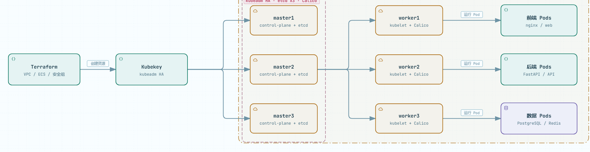

# vmware-to-kubernetes

把 VMware 虚拟机上的 Docker Compose 业务迁移到 Kubernetes，并支持在阿里云一键创建 **3 主 N 从 kubeadm HA 集群**。

项目适合中小项目、课程实验和 POC：输入一个可运行的 `docker-compose.yml`，输出可审查的 K8s 清单，并完成镜像分发、部署、滚动等待和 HTTP 验证。

## 目录

- [运维工具简介](#运维工具简介)
- [项目概览](#项目概览)
- [架构](#架构)
- [功能特性](#功能特性)
- [环境要求](#环境要求)
- [快速开始：阿里云](#快速开始阿里云)
- [数据迁移参考（datamigrate）](#数据迁移参考datamigrate)
- [k8slab 使用手册](#k8slab-使用手册)
- [部署到已有 K8s 集群](#部署到已有-k8s-集群)
- [Compose 转换规则](#compose-转换规则)
- [示例项目](#示例项目)
- [运维与安全](#运维与安全)
- [故障排查](#故障排查)
- [测试与验证](#测试与验证)
- [目录结构](#目录结构)
- [License](#license)

## 运维工具简介

`vmware-to-kubernetes` 是一个面向**云计算运维、DevOps、SRE 和平台工程**的 Kubernetes 自动化运维工具。它覆盖云资源创建、集群安装、应用发布、状态检查和资源清理，并提供部署验证与故障排查手册，适合课程实验、POC、中小项目和内部运维平台。

适合运维工程师、DevOps/SRE、平台工程人员，以及需要做 Kubernetes 课程实验或迁移验证的开发者。

核心能力：

- 在阿里云创建 3 主 N 从 kubeadm HA 集群，包含 VPC、安全组、ECS 和 SLB。
- 把 Docker Compose 转换为可审查的 Kubernetes 清单，支持本机构建、离线镜像包和私有仓库。
- 提供 `doctor`、`status`、`destroy` 等运维命令，以及部署后的 HTTP 验证。
- 内置安全默认值：收敛公网入口、随机节点密码、内网 SLB API、忽略敏感文件。
- 附带数据迁移参考工具，适合验证迁移流程，不作为生产迁移的唯一保障。

**相关关键词**：运维工具、云计算运维、Kubernetes 运维、K8s 集群部署、DevOps 工具、SRE、自动化运维、Terraform、Kubekey、Docker Compose 迁移、阿里云运维、故障排查、SLB、Ingress。

> 本项目不是通用监控、日志、CMDB、堡垒机或备份平台；这些能力需要结合 Prometheus、Grafana、Loki、ELK、云监控等外部系统。

## 项目概览

### 工具组成

| 工具 | 作用 | 典型命令 |
|---|---|---|
| `k8slab.py` | 创建阿里云 VPC/ECS/安全组/SLB，安装 Kubekey 集群，并部署应用 | `k8slab.py up` |
| `course-selection/vm2k8s.py` | 把 Compose 转成 K8s 清单，部署到已有集群 | `vm2k8s.py ship` |
| `course-selection/datamigrate.py` | 可选参考：迁移数据库和文件卷，不参与一键部署 | `datamigrate.py run` |

`k8slab` 内部会调用 `vm2k8s`；也可以只使用 `vm2k8s`，把应用部署到已有 kubeadm/K3s 集群。`datamigrate` 独立于部署流程，仅作参考；需要搬迁数据时使用，生产迁移需自行验证。

### 适用场景

- 已能通过 `docker compose up` 运行的前端 + API + 数据库/缓存项目。
- 无状态服务多副本，或单实例有状态服务（MySQL、PostgreSQL、Redis、MongoDB）。
- 内部工具、管理后台、官网、POC、课程和实验项目。
- 目标集群为已有 kubeadm/K3s 集群，或由本工具创建的阿里云集群。

### 不适用场景

- 依赖 host 网络、`privileged`、GPU/串口直通或 systemd 管理的项目。
- 需要 RWX 共享存储，或需要多个副本同时写同一数据目录。
- 大型微服务集群，或强依赖 Service Mesh、灰度、HPA、NetworkPolicy 的项目。
- 生产级数据库、消息队列；建议使用云数据库或 Operator。
- Windows 容器。
- 强依赖复杂启动顺序和初始化脚本的项目；需要改写为 initContainer/Job。

## 架构



### 集群拓扑

- 3 台 master 组成 etcd 三副本控制面，默认通过内网 SLB 暴露 API Server 6443。
- N 台 worker 运行工作负载；默认 3 台，可通过 `--workers` 调整。
- 默认安装 Calico CNI 和 local-path StorageClass。
- 默认使用 Docker 24 + cri-dockerd；如需 containerd，可参考相邻的 `k8s-iac` 项目。
- 节点、VPC、安全组、SSH 密钥、SLB 均由 Terraform 创建。
- `--no-ha` 可关闭 SLB，API 回退到 master1 单点。

## 功能特性

- 一条命令创建阿里云基础设施和 3 控制面 kubeadm HA 集群。
- Compose 通用转换：端口、环境变量、命令、卷、健康检查、资源限制、secrets/configs。
- 支持 `ports` 的 NodePort 暴露；可选 nginx Ingress。
- 镜像交付支持本机构建、离线镜像包和私有镜像仓库。
- `--private-registry`：K8s 基础镜像只在 master 拉取一次，其他节点从 master 拉取。
- 自动生成 `06-deploy.sh`（apply + NodePort 分配）和 `MIGRATION.md`（服务表 + 风险告警）。
- 针对国内网络适配：Kubekey 国内镜像、节点镜像加速、local-path、SSH 重试、systemd 托管后台任务。
- 支持 `--depends-init` 将 Compose 启动依赖近似转换为 TCP 等待 initContainer。
- 支持 `--strict-bind`，避免目录型 bind mount 被静默跳过。
- 支持离线 CNI/local-path manifest 和 SHA256 校验。

## 环境要求

| 项目 | 要求 |
|---|---|
| 操作系统 | Windows 10+ / macOS / Linux |
| Python | 3.8+，依赖 `pyyaml` |
| SSH | `ssh`、`scp`、`ssh-keygen` |
| Terraform | 缺失时自动下载；也可通过 `TERRAFORM_PATH` 指定 |
| Docker | 可选，仅 `build` / `registry` 镜像模式需要 |
| 阿里云 | AK/SK；RAM 用户建议 `AliyunECSFullAccess` + `AliyunVPCFullAccess`；启用 SLB 时还需 `AliyunSLBFullAccess` |
| 网络 | 可访问阿里云 API；master 可访问 `registry.cn-beijing.aliyuncs.com` |
| 项目输入 | 可运行的 `docker-compose.yml` |

使用 `k8slab` 时本机不需要安装 kubectl 或 Kubekey，集群操作在 master 上执行；只用 `vm2k8s` 部署到已有集群时，需要本机 kubectl 或 SSH。

如果目标网络无法访问 GitHub 或 `registry.terraform.io`，可先导出带 provider 的离线工具包：

```bash
python k8slab.py export --out k8slab-kit.zip --with-provider
```

### 输入要求

- 工具以单个 `docker-compose.yml` 为输入，不解析裸进程、systemd unit 或 VM 镜像。
- 没有 compose 文件时，需要先根据 `docker run`、systemd、端口和挂载信息自行编写，并确保 `docker compose up` 能跑通。
- 转换器只生成部署清单和空 PVC。数据迁移不在主流程内；`datamigrate.py` 仅提供参考计划和脚本，生产环境仍需自行安排停机窗口、备份、校验与回滚。

## 快速开始：阿里云

### 1. 安装依赖并检查环境

```bash
python -m pip install pyyaml
python k8slab.py doctor
```

### 2. 创建集群并部署示例

```bash
python k8slab.py up \
  --compose examples/library-app/docker-compose.yml \
  --ak <AccessKeyId> --sk <AccessKeySecret> \
  --private-registry --nodeport-start 30111
```

也可以使用环境变量提供凭证：

```bash
export ALICLOUD_ACCESS_KEY=<AccessKeyId>
export ALICLOUD_SECRET_KEY=<AccessKeySecret>
python k8slab.py up --compose examples/library-app/docker-compose.yml
```

该示例包含 `build` 段，默认的 `auto` 模式会在本机 Docker 中构建镜像；没有 Docker 时，请先准备 `images.tar.gz`，再加 `--image-mode save --bundle images.tar.gz`。

示例项目文件说明：

| 文件 | 是否必需 | 用途 |
|---|---|---|
| `examples/library-app/docker-compose.yml` | 是 | 工具的唯一输入 |
| `examples/library-app/app.env` | compose 引用 | `env_file` |
| `examples/library-app/backend/Dockerfile` | `--image-mode build` 时需要 | 构建后端镜像 |
| `examples/library-app/frontend/nginx.conf` | compose 引用 | 单文件 bind mount |
| `images.tar.gz` | `--image-mode save` 时需要 | 预导出的镜像包 |

### 3. 查看状态与销毁

```bash
# 查看最近一次运行
python k8slab.py status

# 查看指定运行目录
python k8slab.py status --run "<workdir>"

# 销毁最近一次运行创建的资源
python k8slab.py destroy

# 销毁并删除本地运行记录
python k8slab.py destroy --run "<workdir>" --purge
```

运行目录默认是 `~/.k8slab/runs/<项目名>-<时间戳>`，里面有 `run.json`、`node_password.txt`、`kubekey-cluster.yaml` 和生成的 K8s 清单。不要分享整个运行目录。

### `up` 执行流程

1. Terraform 创建 VPC、安全组、SSH 密钥、3 台 master、N 台 worker，以及内网 SLB API 入口。
2. Kubekey 安装 kubeadm HA 集群（etcd 三副本 + Calico）。
3. 配置节点镜像加速、安装 local-path 默认 StorageClass。
4. `vm2k8s` 转换 Compose，构建或分发镜像。
5. apply 清单、分配 NodePort、等待滚动更新、执行 HTTP 验证。

## 数据迁移参考（datamigrate）

> 本节仅作参考，不属于 `k8slab up` 的必需流程。`datamigrate.py` 用于生成迁移计划、脚本和工件，便于验证迁移思路；生产迁移仍需结合停机窗口、备份、校验和回滚预案人工执行。

`course-selection/datamigrate.py` 在应用部署完成后迁移数据库与文件卷，不保证零停机或生产级一致性。

- `plan` 只分析 Compose 并生成计划，不连接源端或目标集群。
- `run` 按阶段执行，支持 `--dry-run`、`--resume` 和 `--only`。
- 备份和恢复通过容器/Pod 内的数据库客户端完成。

### 1. 生成计划

```bash
python course-selection/datamigrate.py plan \
  --compose docker-compose.yml --out data-migration --namespace app \
  --source-ssh devops@192.168.110.128 --source-key keys/id_ed25519 \
  --source-dir /home/devops/apps/library-app \
  --target-ssh root@<master1> --target-key keys/id_ed25519
```

### 2. 预览

```bash
python course-selection/datamigrate.py run \
  --plan data-migration/migration-plan.json --phase all --dry-run
```

### 3. 分阶段执行

```bash
python course-selection/datamigrate.py run --plan data-migration/migration-plan.json --phase preflight
python course-selection/datamigrate.py run --plan data-migration/migration-plan.json --phase dump
python course-selection/datamigrate.py run --plan data-migration/migration-plan.json --phase transfer
python course-selection/datamigrate.py run --plan data-migration/migration-plan.json --phase restore --yes
python course-selection/datamigrate.py run --plan data-migration/migration-plan.json --phase verify
python course-selection/datamigrate.py run --plan data-migration/migration-plan.json --phase start
```

### 参考支持范围

| 数据 | 备份 | 恢复 |
|---|---|---|
| MySQL / MariaDB | `mysqldump` / `mariadb-dump` | `mysql` 客户端导入 |
| PostgreSQL | `pg_dump` 纯 SQL | `psql` 导入 |
| Redis | `redis-cli --rdb` | RDB 恢复到 PVC（目标不要启用 AOF） |
| MongoDB | `mongodump --archive --gzip` | `mongorestore` |
| SQLite / 命名卷 | `tar.gz` 归档 | helper Pod 解包 |
| bind 目录 | `tar.gz` 归档 | 仅备份，不自动恢复 |

### 常用选项

| 选项 | 说明 |
|---|---|
| `--source-project` | Compose 项目名；默认取 Compose 目录名 |
| `--source-dir` | 源项目目录；SSH 模式下解析 bind 路径 |
| `--volume-map` | 源卷名映射，如 `mysql-data=myproj_mysql-data` |
| `--include-bind-dirs` | 把 bind 目录加入归档计划 |
| `--helper-image` | 原始卷恢复镜像；镜像缺少 `sh`/`tar` 时使用 |
| `--resume` | 跳过已完成的 dump |
| `--verify-rows` / `--no-verify-rows` | 控制行数校验 |
| `--stop-apps` / `--no-stop-apps` | 控制恢复前是否缩容应用 |
| `--clean-volume` / `--no-clean-volume` | 控制恢复前是否清空目标卷 |

### 注意事项

- 计划产物包括 `migration-plan.json`、`RUNBOOK.md`、`scripts/*.sh`、`scripts/*.ps1` 和 `artifacts/`。
- 源端卷名默认按 `<项目名>_<卷名>` 和原名探测；特殊卷名使用 `--volume-map`。
- 密码不写入计划：执行时在容器/Pod 内通过环境变量读取。
- `restore` 会先缩容非数据库服务，失败时保持停止；修复后执行 `verify`，再执行 `start`。
- SQLite 和原始卷恢复需要停止目标 Deployment，工具自动处理。
- 原始卷恢复默认复用服务镜像；distroless 等镜像缺少工具时加 `--helper-image busybox:1.36`。
- 生产迁移请先在预发环境演练，并保留可回滚备份；不要把本工具当作生产迁移的唯一保障。

## k8slab 使用手册

### 命令

| 命令 | 说明 |
|---|---|
| `python k8slab.py doctor` | 检查 Python、SSH、Terraform、Docker 和文件完整性 |
| `python k8slab.py up` | 创建阿里云资源、安装集群、部署应用 |
| `python k8slab.py status` | 查看集群、Pod、Service 和访问地址 |
| `python k8slab.py destroy` | 销毁资源，停止计费 |
| `python k8slab.py export` | 导出可离线使用的新电脑工具包 |

### 常用参数

| 参数 | 说明 |
|---|---|
| `--compose PATH` | 必填，Compose 文件路径 |
| `--project NAME` | 项目名，默认取 Compose 所在目录名 |
| `--namespace NAME` | 目标命名空间，默认由项目名生成 |
| `--ak` / `--sk` | 阿里云凭证；也可用 `ALICLOUD_ACCESS_KEY` / `ALICLOUD_SECRET_KEY` |
| `--region` | 地域，默认 `cn-guangzhou` |
| `--workers N` | worker 数量，默认 3 |
| `--password VALUE` | 节点 root 密码；不传则自动生成并写入 `node_password.txt` |
| `--bandwidth N` | ECS 公网出带宽，默认 5 Mbps |
| `--admin-cidr CIDR` | 允许 SSH/NodePort 的来源；默认自动检测本机公网 IP |
| `--nodeport-cidr CIDR` | 允许 NodePort 的来源；默认复用 `--admin-cidr` |
| `--web-cidr CIDR` | 允许 80/443 的来源，默认 `0.0.0.0/0`；留空关闭 |
| `--no-ha` | 不创建内网 SLB，API 回退到 master1（省费用） |
| `--nodeport-start N` | NodePort 起始端口，默认 30080 |
| `--image-mode MODE` | `auto` / `none` / `build` / `save` / `registry` |
| `--bundle PATH` | `save` 模式使用的镜像包 |
| `--registry PREFIX` | `registry` 模式的仓库前缀 |
| `--private-registry` | K8s 基础镜像从 master registry 分发 |
| `--ephemeral` | 用 emptyDir 代替 PVC |
| `--strict-bind` | bind 目录/缺失源直接失败 |
| `--depends-init` | 将 `depends_on` 近似转为 TCP 等待 initContainer |
| `--init-image IMAGE` | initContainer 镜像，默认 `busybox:1.36` |
| `--ingress` | 生成 nginx Ingress（需已有 ingress-controller） |
| `--ingress-host HOST` | 基础域名；k8slab 默认 `<master1>.nip.io` |
| `--ingress-map MAP` | 显式映射：`服务=域名[/路径],...` |
| `--ingress-class CLASS` | IngressClass，默认 `nginx` |
| `--ingress-tls-secret NAME` | 已有 TLS Secret 名称 |
| `--verify SPEC` | 部署后验证：`svc=/path,svc2=/health` |
| `--workdir PATH` | 指定运行目录 |
| `--dry-run` | 只检查并展示计划，不创建资源 |

完整参数以 `python k8slab.py up --help` 为准。

### 镜像模式

| 模式 | 适用场景 | 行为 |
|---|---|---|
| `auto` | 默认 | 有 `--bundle` 用 `save`；有 `build` 且本机 Docker 可用用 `build`；否则 `none` |
| `none` | 公共镜像 | 节点通过网络或镜像加速拉取 |
| `build` | 含 `build` 段 | 本机 Docker 构建并在需要时导出镜像包 |
| `save` | 离线环境 | 使用 `--bundle` 指定的镜像包 |
| `registry` | 已有镜像仓库 | 构建并推送，节点从仓库拉取 |

### K8s 基础镜像与私有 registry

`--private-registry` 与业务镜像模式相互独立：

- K8s 系统镜像只在 master 拉取一次。
- 其他节点从 master 的本地 registry 拉取。
- 适合国内网络或节点无法直接访问镜像仓库的场景。
- 使用前确认 master 磁盘空间足够。

### 可选：Ingress

默认只生成 NodePort。需要域名访问时加 `--ingress`：

```bash
# 每个服务一个子域名：<service>.<host>
python course-selection/vm2k8s.py convert \
  --compose docker-compose.yml --out k8s --namespace app \
  --ingress --ingress-host example.com

# 显式映射：服务=域名[/路径]
python course-selection/vm2k8s.py convert \
  --compose docker-compose.yml --out k8s --namespace app \
  --ingress --ingress-map "frontend=app.example.com,backend=api.example.com"

# 使用已有 TLS Secret
python course-selection/vm2k8s.py convert \
  --compose docker-compose.yml --out k8s --namespace app \
  --ingress --ingress-host example.com --ingress-tls-secret app-tls
```

说明：

- 只为 `ports` 发布且端口属于 HTTP 的 Service 生成 Ingress，`expose` 不会暴露。
- 不传 host 时退化为路径 `/<service>`，并添加 nginx rewrite 注解。
- 生成 `07-ingress.yaml`；NodePort 仍保留作为回退。
- 集群需要 ingress-controller：`bash scripts/install-ingress-nginx.sh`。
- TLS 只引用已有 Secret，不包含 cert-manager。
- `k8slab --ingress` 默认使用 `<master1公网IP>.nip.io`，无需配置 DNS。

## 部署到已有 K8s 集群

只需要转换和部署时，直接使用 `vm2k8s`。以下命令在仓库根目录执行：

```bash
# 1. 评估迁移批次
python course-selection/vm2k8s.py assess --compose docker-compose.yml

# 2. 生成 K8s 清单
python course-selection/vm2k8s.py convert \
  --compose docker-compose.yml --out k8s --namespace app \
  --nodeport-start 30111

# 3. 一键部署：镜像分发 + apply + 滚动等待 + 验证
python course-selection/vm2k8s.py ship \
  --compose docker-compose.yml --namespace app \
  --image-mode save --bundle images.tar.gz \
  --remote root@<master1> --ssh-key keys/id_ed25519 \
  --node-password '<节点密码>' \
  --nodeport-start 30111 --verify frontend=/
```

如果 kubectl 已经指向目标集群，可以省略 `--remote`，使用本机 kubectl 部署：

```bash
python course-selection/vm2k8s.py ship \
  --compose docker-compose.yml --namespace app \
  --image-mode none --nodeport-start 30111
```

生成物：

| 文件 | 内容 |
|---|---|
| `00-namespace.yaml` | Namespace |
| `01-configmap.yaml` | 非敏感环境变量、bind 文件 |
| `02-secret.yaml` | 密码、Token、命令中提取的密钥 |
| `03-deployments.yaml` | Deployment |
| `04-services.yaml` | Service |
| `05-pvcs.yaml` | PVC（使用命名卷时） |
| `06-deploy.sh` | apply + NodePort 分配 |
| `07-ingress.yaml` | 可选 Ingress |
| `MIGRATION.md` | 服务表、风险告警、已知限制 |

常用转换参数：

| 参数 | 说明 |
|---|---|
| `--ephemeral` | 用 emptyDir 代替 PVC |
| `--image-map` | `服务=镜像,服务=镜像` |
| `--strict-bind` | bind 目录/缺失源直接失败 |
| `--depends-init` | 将 `depends_on` 转为 TCP 等待 initContainer |
| `--init-image` | initContainer 镜像，默认 `busybox:1.36` |
| `--ingress` | 生成 Ingress |
| `--ingress-host` | 基础域名 |
| `--ingress-map` | 显式域名映射 |
| `--ingress-class` | IngressClass |
| `--ingress-tls-secret` | 已有 TLS Secret |

### 远端部署的文件要求

```text
docker-compose.yml        必需
images.tar.gz             save 模式必需
keys/id_ed25519           远端 SSH 必需
Dockerfile + 构建上下文    build 模式必需
```

## Compose 转换规则

### 支持的 Compose 特性

| Compose 特性 | 转换结果 |
|---|---|
| `image` / `build` | Deployment；多 build 自动命名 `local/<service>:latest` |
| `ports` / `expose` | Service；`ports` 分配 NodePort |
| `environment` / `env_file` | ConfigMap 与 Secret 拆分注入 |
| `command` / `entrypoint` | 字符串转 `/bin/sh -c`，列表原样保留 |
| named / anonymous volume | PVC（`--ephemeral` 时 emptyDir） |
| 单文件 bind mount | ConfigMap + subPath |
| `healthcheck` | HTTP URL → httpGet，否则 tcpSocket |
| `deploy.resources` / `replicas` | requests/limits + 副本数 |
| compose `secrets` / `configs` | K8s Secret/ConfigMap + subPath |
| `labels` / `working_dir` / `user` | 标签 / workingDir / securityContext |
| `depends_on` | 默认忽略；`--depends-init` 转为 TCP initContainer |

### 已知限制

**Compose 与转换**

- 仅支持单个 Compose 文件；`profiles` 不展开，多文件 override 需先合并。
- 只有 `ports` 会生成 NodePort；`expose` 只生成集群内 ClusterIP。
- NodePort 从 `--nodeport-start` 起按 Compose 顺序分配，有效范围 30000-32767。
- 健康检查只识别简单 HTTP URL 或 TCP，复杂脚本退化为 TCP 探针。
- 默认 resources 为 requests 100m/128Mi、limits 1C/1Gi，可通过 `deploy.resources` 覆盖。
- Secret 依据变量名（PASS/SECRET/TOKEN）拆分；`command`/`entrypoint` 中的 `--requirepass`、`--password` 等参数会提取到 Secret。
- 生产环境建议接入 KMS 或外部 Secret，不要把长期密钥直接放在清单里。

**存储与数据**

- named volume 转为 PVC；local-path 使用节点本地盘，只支持单副本读写（RWO）。
- 单文件 bind mount 转为 ConfigMap；目录型/缺失 bind mount 默认跳过并告警，`--strict-bind` 会直接失败。
- 数据迁移仅作参考：`datamigrate` 默认需要停机窗口，不处理增量同步、CDC 或跨数据库 schema 转换。
- `datamigrate` 的逻辑恢复会覆盖同名对象，不是零停机方案。

**启动顺序与集群**

- `depends_on` 默认不建模启动顺序；`--depends-init` 只等待 TCP 端口，不等待业务健康检查。
- `service_completed_successfully` 类型的依赖不会生成 initContainer，会记录告警。
- 集群架构为 `linux/amd64`；Apple Silicon 构建时自动设置 `DOCKER_DEFAULT_PLATFORM=linux/amd64`。
- 课程集群固定 Kubernetes 1.28.2（Kubekey 兼容性）；该版本已 EOL，生产环境应升级到受支持版本并改用 containerd。
- 默认运行时为 Docker 24.0.9 + cri-dockerd；不要手工安装 Docker 25 及以上版本。

**网络与安全**

- 默认创建内网 SLB（TCP 6443）作为三台 master 的 API 入口；`--no-ha` 可回退到 master1 单点。
- 安全组默认只允许 `admin_cidr` 访问 SSH/NodePort；`k8slab up` 自动检测本机公网 IP。
- 直接使用 Terraform 时必须设置 `admin_cidr`，否则不会创建 SSH/NodePort 规则。
- 6443 默认不对公网开放；需要公网 kubectl 时使用 SSH 隧道。
- 80/443 默认公开，可用 `web_cidr` 关闭。
- 节点 SSH 当前使用 root + 密码（Kubekey 配置）；生产环境建议切换密钥登录并限制来源。
- 离线环境可在执行 `bootstrap-cluster.sh` 时提供 `CALICO_MANIFEST`/`CALICO_SHA256`、`LOCAL_PATH_MANIFEST`/`LOCAL_PATH_SHA256`，跳过下载并校验文件。

## 示例项目

`examples/` 下提供四个可直接运行的全栈示例：

| 项目 | 组件 | 演示点 |
|---|---|---|
| `todo-app` | nginx + FastAPI + SQLite | PVC 持久化 |
| `weather-dashboard` | nginx + FastAPI | 基础 Web 服务 |
| `url-shortener` | nginx + FastAPI + Redis | Redis 密码、env 注入 |
| `library-app` | nginx + FastAPI + PostgreSQL | bind 配置、HTTP 探针、resources、Secret |

`course-selection/` 是选课系统源码（FastAPI + MySQL + Redis Lua），附带 1000 并发抢课压测脚本。

## 运维与安全

### 状态与清理

```bash
# 查看最近一次运行
python k8slab.py status

# 查看指定运行
python k8slab.py status --run "<workdir>"

# 销毁资源
python k8slab.py destroy --run "<workdir>"

# 直接使用 Terraform
terraform destroy -auto-approve
```

### 安全默认值

- `terraform.tfvars`、`keys/`、`*.tfstate`、`node_password.txt`、`backend.tf` 已加入 `.gitignore`。
- 直接使用 Terraform 时，`node_password` 无默认值，必须显式提供。
- `k8slab` 未传 `--password` 时会生成随机密码，并写入权限 600 的 `node_password.txt`。
- `admin_cidr` 默认自动检测本机公网 IP；SSH/NodePort 不再默认对 `0.0.0.0/0` 开放。
- 6443 默认不开放；不要直接把 API Server 暴露到公网。
- `k8slab` 会在运行目录写入 `node_password.txt` 和 `kubekey-cluster.yaml`，不要分享整个目录。
- `deploy.ps1` 是兼容脚本，新环境优先使用 `k8slab.py`；它要求 `K8S_NODE_PASSWORD`，不再硬编码 Terraform 路径。
- 节点 SSH 当前使用 root + 密码；生产环境建议改为密钥登录，并进一步收紧 `admin_cidr`。

### 远程 state（可选）

`tfstate` 包含节点密码等敏感信息，默认只保存在本地且未加密。生产环境建议迁移到阿里云 OSS：

```bash
cp backend.tf.example backend.tf
# 修改 bucket / key / region
terraform init -migrate-state
```

`backend.tf` 已加入 `.gitignore`。OSS backend 不提供状态锁，多人同时操作前需要自行协调。

### 手动部署兼容脚本

`deploy.ps1` 保留用于手动分步部署。它需要：

- Terraform 已在 `PATH` 中，或设置 `TERRAFORM_PATH`。
- 设置 `K8S_NODE_PASSWORD`，或传入 `-NodePassword`。
- 已存在的 `keys/id_ed25519` 和 Terraform outputs。

新环境优先使用 `k8slab.py`。

## 故障排查

| 现象 | 原因 | 处理 |
|---|---|---|
| Kubekey 卡住 | `dl.k8s.io` 不可达 | 安装脚本固定 `KKZONE=cn` |
| SLB 后端健康检查失败 | 安全组未放行 VPC 内 6443，或 SLB 与 ECS 不在同一 VPC | 检查 `intra` 规则；`terraform output api_endpoint` 应为 SLB 地址 |
| PVC Pending | kubeadm 无默认 StorageClass | 自动安装 local-path 并设为默认 |
| 节点拉取镜像失败 | Docker Hub 不可达 | 配置节点镜像加速，或使用离线镜像包 |
| local-path 拉取失败 | Docker Hub 偶发不通 | bootstrap 自动预拉取重试；仍失败时离线导入 |
| Redis 启动失败 | 未复制 command/env，或缺少密码参数 | 检查 `command`/`args` 和 Secret 注入 |
| SSH 中断导致安装失败 | 前后台进程绑定 | Kubekey 由 systemd 托管，SSH 操作自动重试 |
| bind 目录没有进入清单 | 目录型 bind 默认跳过 | 使用 `--strict-bind` 提前失败，或手工改为 ConfigMap/PVC |
| depends_on 未等待依赖 | 默认不建模启动顺序 | 加 `--depends-init`，或让应用自行重试连接 |

## 测试与验证

```bash
python course-selection/tests/run_fixtures.py
python tests/test_datamigrate.py
python course-selection/tests/test_k8slab.py
```

测试覆盖：

- `run_fixtures.py`：11 类场景，包括 WordPress+MySQL、Prometheus+Grafana、字符串 command、多 build、HTTP 探针、bind + secret、expose-only、Ingress、命令密码提取、`--strict-bind`、`--depends-init`。
- `test_datamigrate.py`：MySQL/PostgreSQL/SQLite/命名卷/Redis 无卷/bind 目录、`--source-dir`、`--dry-run`、`--no-stop-apps`、产物清单。
- `test_k8slab.py`：名称清洗、Kubekey 配置、SLB `api_endpoint` 回退。

四个示例项目已在 VMware k3s 完成「Compose 运行 → 转换 → 部署 → 写入/读取 → 删除 Pod 后 PVC 数据保留」验证，并在阿里云 3 主 3 从集群完成端到端复验：

| 项目 | NodePort | 验证结果 |
|---|---|---|
| `todo-app` | 30101/30102 | 页面 200；待办增查；删 Pod 后数据保留 |
| `weather-dashboard` | 30103/30104 | 页面 200；天气 API 返回 JSON |
| `url-shortener` | 30105/30106/30107 | 页面 200；短链写入 Redis；密码鉴权生效 |
| `library-app` | 30111 | 页面 200；图书增查/借还；删 db Pod 后数据保留 |

## 目录结构

```text
.
├── k8slab.py                     # 集群编排入口：doctor/up/status/destroy/export
├── main.tf / variables.tf / outputs.tf
├── backend.tf.example            # 可选 OSS 远程 state
├── deploy.ps1                    # 手动分步部署兼容脚本
├── cloud-init/                   # 节点初始化
├── scripts/
│   ├── install-kk.sh             # 安装 Kubekey
│   ├── bootstrap-cluster.sh      # 镜像加速 / CNI / 存储类
│   ├── push-k8s-images.sh        # 推送 K8s 镜像
│   ├── distribute-images.sh      # 节点镜像离线分发
│   ├── install-ingress-nginx.sh  # Ingress Controller
│   └── ...
├── course-selection/
│   ├── vm2k8s.py                 # assess / convert / ship
│   ├── datamigrate.py            # 数据迁移参考：plan / run
│   ├── app/                      # 示例后端
│   ├── k8s/                      # 生成的示例清单
│   ├── loadtest/                 # 1000 并发压测
│   └── tests/                    # 转换器与数据迁移测试
├── examples/                     # 四个全栈示例
├── docs/assets/                  # 架构图
└── README.md
```

运行时生成、默认不提交的目录：

- `keys/`：SSH 密钥。
- `data-migration/`：迁移计划、脚本和工件。
- `*-k8s/`：生成的 K8s 清单。
- `~/.k8slab/runs/`：`k8slab` 运行目录。
- `terraform.tfstate`、`backend.tf`、`node_password.txt`：敏感或环境相关文件。

## License

MIT
